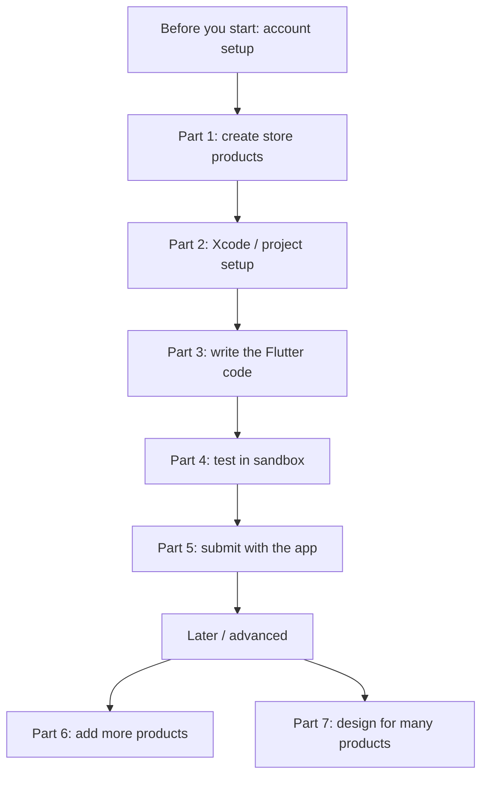
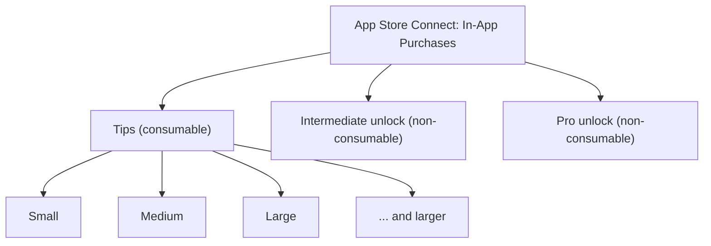
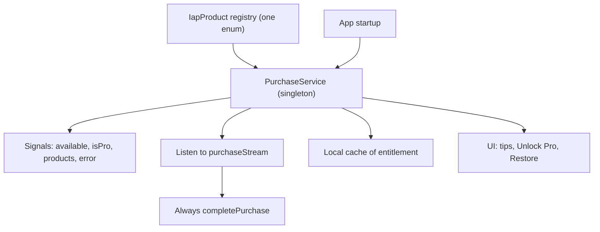
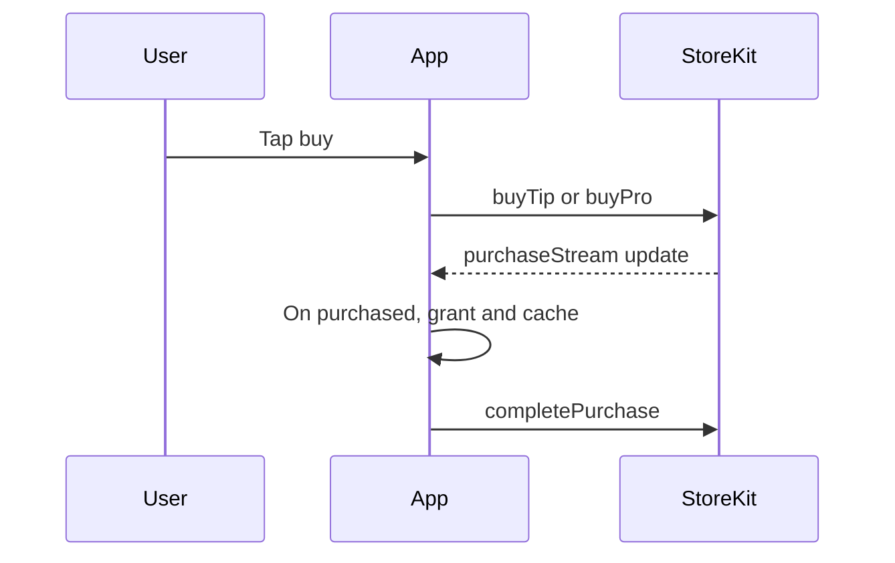
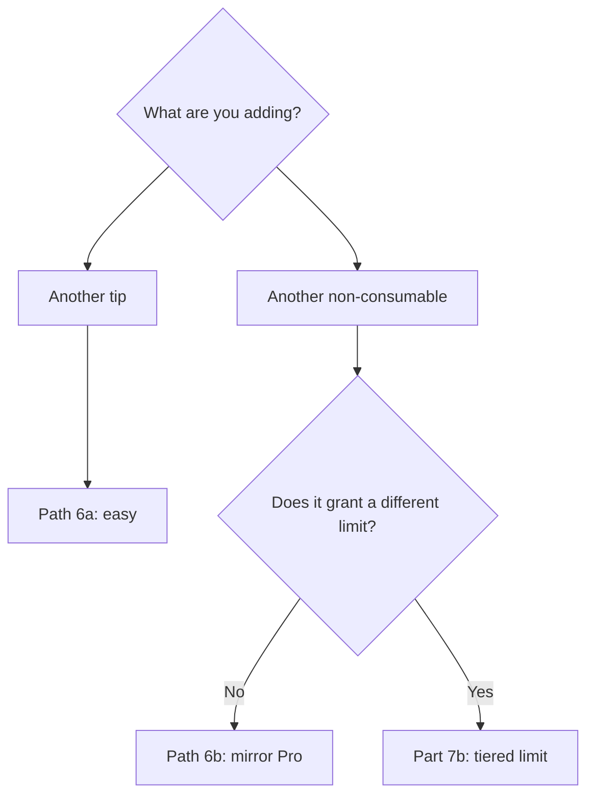
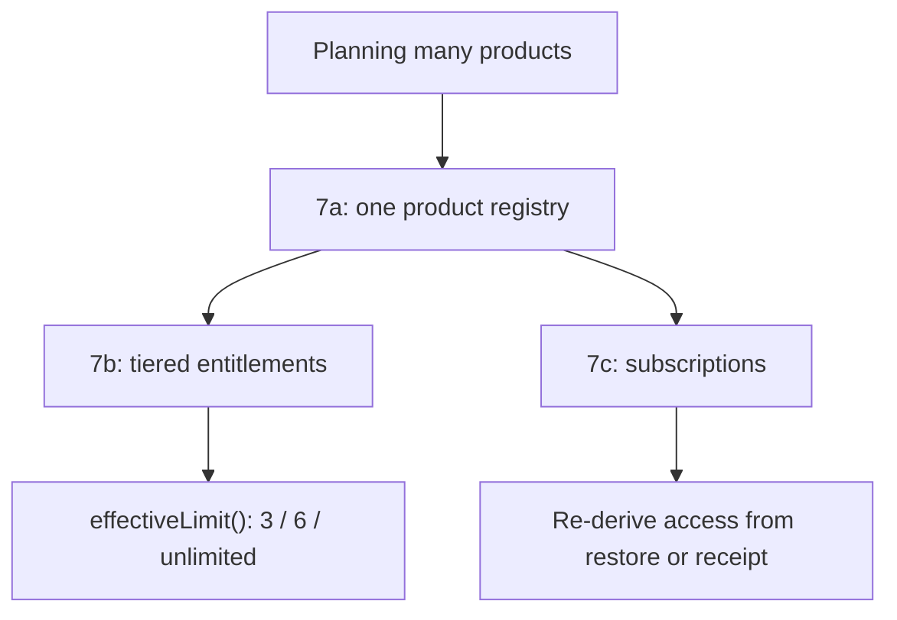

# Adding In-App Purchases — a reusable playbook
##### (c)2026 Stephanie Patterson, Geek Me Speak LLC
##### License: MIT License 
---

 **This is a reusable guide.**
 - Use it to add in-app purchases to any **Flutter** app.
 - It targets **iOS and macOS**.
 - Android comes later.
>
>**MyApp** is the worked example throughout.
>
>The worked example sells two things: **tips** and a **Pro unlock**.

 - Follow the Parts in order.  Do the **store setup first**. Then do the **code**.

 - You cannot test the code until the store products exist.

> **How to read this doc:**
>
>- Each Part is a stage. Do the Parts top to bottom.
>
>
>- A checkbox line is an action to take.
>
>
>- A line in *italics marked MyApp* shows how the example app did it.

### The whole journey at a glance

## The plan in plain words

- **Tips** = "buy me a coffee". The user can buy them again and again.
  These are called **consumables**.

- **Pro unlock** = pay once, unlock a feature forever.
  This is called **non-consumable**.

- The app stays **free**. Tips and Pro are both optional.

> **MyApp worked example.**
>
> Free users get the basics.
>
> Going over shows a centered upsell dialog.
>
> The dialog offers a **Intermediate** tier and a **Pro** unlock.
>
> Pro unlocks **unlimited**. It also may add the **additional** items.
>
> Part 3 lists the build steps. Each step notes the MyApp file.

## Words you'll see (quick glossary)

- **Consumable** — can be bought many times (our tips).

- **Non-consumable** — bought once, kept forever (our Pro unlock).

- **StoreKit** — Apple's system that handles the actual payment.
  The Flutter plugin talks to it for us.

- **Sandbox** — Apple's test mode. You buy with a fake test account,
  so no real money changes hands.

- **Paid Applications Agreement** — a contract you sign in App Store
  Connect. Without it, no purchases work — even for a free app.

## Before you start (one-time account setup)

Do these once. They live in **App Store Connect → Business**.

- [ ] Sign the **Paid Applications Agreement**.

- [ ] Fill in **Bank details** (where money is paid to).

- [ ] Fill in **Tax forms** (Apple requires these before selling).

- [ ] Create a **Sandbox tester** account:
      Users and Access → **Sandbox** → Test Accounts → **＋**.
      Use an email you do NOT already use for Apple.

> Nothing works until the agreement is **Active**.
>
> Banking and tax must be complete too.
>
> This can take a little time to process. Do it first.

## Part 1 — Create the products in App Store Connect

Go to your app → **Monetization → In-App Purchases**.

Create one product for each thing you sell.

### The products to create

### Product IDs

Pick a clear ID pattern. Use the **same ID** in the store and in the code.

The pattern is `com.<company>.<app>.<thing>`.

*MyApp example:*

- Tip (small): `com.company.myapp.tip.small`

- Tip (medium): `com.company.myapp.tip.medium`

- Tip (large): `com.company.myapp.tip.large`

- Tip (extra large): `com.company.myapp.tip.XLarge`

- Tip (extra extra large): `com.company.myapp.tip.XXLarge`

- Intermediate unlock: `com.company.myapp.intermediate`

- Pro unlock: `com.company.myapp.pro`

### For each tip (a consumable)

- [ ] Click **＋**. Choose **Consumable**.

- [ ] Set a **Reference Name**. This is private. Example: "Tip - Small".

- [ ] Set the **Product ID** to match your code.

- [ ] Pick a **Price**. *MyApp: $0.99 up to $19.99.*

- [ ] Add a **Display Name** and a **Description**. The user sees these.

- [ ] Add one **review screenshot** and short **review notes**. Apple needs these.

### For the Intermediate and Pro unlock (a non-consumable)

- [ ] Click **＋**. Choose **Non-Consumable**.

- [ ] Set a **Reference Name**. Example: "Pro Unlock".

- [ ] Set the **Product ID**. *MyApp: `com.company.myapp.pro`.*

- [ ] Pick a **Price**. *MyApp: $9.99.*

- [ ] Add a **Display Name** and a **Description**. Say what Pro unlocks.

- [ ] Add the **review screenshot** and notes.

> New products start as **"Ready to Submit"**.
>
> That is fine. You can test them in sandbox before your app is approved.

## Part 2 — Xcode / project setup

Good news: **no entitlement or capability checkbox is needed.**
In-App Purchase is enabled by default on your explicit App ID.

- [ ] (Optional but handy) Add a **StoreKit Configuration file** in
      Xcode so you can test purchases locally without sandbox:
      Xcode → File → New → File from Template... → **StoreKit Configuration File**.
      Then add your product IDs to it.

- [ ] Make sure you are signed into Xcode with your Apple developer
      account.

## Part 3 — Write the Flutter code

The plugin is `in_app_purchase`. Add it to `pubspec.yaml`.

This Part is a **build list**. Each box is a thing to create.

Each box has a *MyApp* note. It shows where the example app put that piece.

### How the pieces fit

### The purchase flow

### 3a — Product registry (one enum)

- [ ] Put every product in **one enum**. This is the single source of truth.

- [ ] Give each entry its store ID and its kind.

- [ ] Make each ID match App Store Connect exactly.

*MyApp: `lib/services/iap_product.dart`.*

    enum IapKind { consumable, nonConsumable, subscription }

    enum IapProduct {
      tipSmall('com.company.myapp.tip.small', IapKind.consumable),
      intermediate('com.company.myapp.intermediate', IapKind.nonConsumable),
      pro('com.company.myapp.pro', IapKind.nonConsumable);

      const IapProduct(this.id, this.kind);
      final String id;
      final IapKind kind;
    }

The service and the UI both derive their lists from this enum.

So adding a product is a **one-line edit** here. See Part 6a.

More on the registry, and why it scales, is in Part 7a.

### 3a-i — What each MyApp product is

The enum above is trimmed for the example. MyApp ships the products below.

**Tip Jar (consumables).**

- Optional donations that support the app.

- They grant **no** features.

- The user can buy them again and again.

- The sizes are just different amounts: `tipSmall`, `tipMedium`, `tipLarge`,
  `tipXLarge`, `tipXXLarge`.

**Non-consumables (bought once, unlock a feature forever).**

- `intermediate` — the "intermediate" tier. It raises the add-at-once 

  from the free limit (`kFreeLimit`) to the mid-tier limit
  (`kIntermediateLimit`).

- `pro` — unlimited benefits. Pro supersedes the intermediate tier.

### 3b — The purchase service

Build a singleton that wraps the plugin.

*MyApp: `lib/services/purchase_service.dart`.*

- [ ] Create the singleton. Example: `final purchaseService = PurchaseService();`.

- [ ] Expose an **available** signal. Is the store reachable?

- [ ] Expose an **isPro** signal. Has the user unlocked the entitlement?

- [ ] Expose a **products** signal. The loaded `ProductDetails`, keyed by ID.

- [ ] Expose an **error** signal. The latest purchase error, or null.

- [ ] Write `init()`. It runs the startup steps.

    - [ ] Restore the cached entitlement flag.
    - [ ] Check availability.
    - [ ] Subscribe to `purchaseStream`.
    - [ ] Call `loadProducts()`.

- [ ] Write `loadProducts()`. It queries `IapProduct.allIds` and fills the products signal.

- [ ] Write `buyTip(product)`. It starts a consumable.

- [ ] Write `buyPro(product)`. It starts the non-consumable.

- [ ] Write `restore()`. It calls `restorePurchases()`. Apple requires this.

- [ ] Write the purchase handler. It reacts to each event.

    - [ ] On purchased or restored: grant the entitlement and cache it.
    - [ ] On error: set the error signal.
    - [ ] Always call `completePurchase` for any pending transaction.

- [ ] Derive the query set from the registry. *MyApp: `IapProduct.allIds`.*

> **Important:** always `completePurchase` a purchased, restored, or errored
> transaction.
>
> If you forget, the store keeps redelivering it.
>
> App Review then rejects the app.

### 3c — Startup wiring

*MyApp: `lib/main.dart`.*

- [ ] Call `WidgetsFlutterBinding.ensureInitialized()` first.
      Make it unconditional. iOS needs it before any plugin work.

- [ ] Then call `await purchaseService.init();`.

- [ ] Do both before `runApp`.

### 3d — Entitlement cache (persistence)

Cache the entitlement locally for a fast start.

*MyApp: `lib/services/settings_service.dart`, keys `is_pro` and `is_intermediate`.*

- [ ] Add a load and a save for each entitlement flag.
      *MyApp: `loadIsPro` and `saveIsPro`, plus `loadIsIntermediate` and `saveIsIntermediate`.*

- [ ] Treat the cache as a hint only.

- [ ] Apple's restore and purchase state stays authoritative.

### 3e — Feature gate + upsell

This is the MyApp free-cap. Adapt it to your own gate.

- [ ] Add your limit constants.
      *MyApp `lib/constants.dart`: `kFreeLimit = 3`, plus grid consts.*

- [ ] Add a pure helper that caps a free pick.
      *MyApp: `applyFreeLimit(...)`, unit-tested.*

- [ ] On over-limit, add the allowed items. Stash the rest.

- [ ] Show an upsell dialog.
      *MyApp: `pro_upsell_dialog.dart`, price from `ProductDetails`.*

- [ ] On decline, drop the stashed rest.

- [ ] On buy success, add the stashed rest.

*MyApp viewmodel `resize_viewmodel.dart` uses these fields and methods:*
*`pendingUpsellPaths`, `pendingUpsellNames`, `showProUpsell`,*
*`declineProUpsell`, `acceptProUpsell`, `addPendingUpsell`.*

*MyApp screen `resize_screen.dart` uses two `effect`s.*
*One opens the dialog. One adds the rest when Pro turns on.*

### 3f — The UI surfaces

- [ ] Add a support area. Put tip buttons, an **Unlock Pro** button,
      and a **Restore Purchases** button in it.

- [ ] Gate your paid feature on the entitlement signal.

*MyApp: `settings_screen.dart` holds the support section.*
*`source_section.dart` shows the Pro grid, or the free strip.*

## Part 4 — Testing (sandbox)

- [ ] On the device: Settings app → sign OUT of the normal App Store
      account **(you'll sign in with the sandbox tester when prompted)**.

- [ ] Run the app, tap a tip, and buy it with your **sandbox tester**.
      No real money is charged.

- [ ] Test **Restore**: delete + reinstall, tap Restore, confirm Pro
      comes back.

- [ ] (If you made a StoreKit config file) you can also test in the
      simulator without signing out — handy for quick checks.

## Part 5 — Before you submit

- [ ] Each product has a **display name, description, price,
      screenshot, and review notes**.

- [ ] The app has a visible **Restore Purchases** button (for Pro).

- [ ] You submit the **in-app purchases together with the app build**
      the first time (attach them to the version in App Store Connect).

- [ ] Purchases were **sandbox-tested** and complete cleanly.

## Part 6 — Adding more in-app purchases later

There are two cases.

1. Adding another **tip**. This is easy.

2. Adding another **non-consumable**. This needs a little thought.

### Which path do I take?

### 6a — Add another tip (consumable)

Repeatable purchases are the simplest to add.

- [ ] **Store.** Create a new **Consumable** product in App Store Connect.
      Give it a new ID. Example: `com.company.myapp.tip.mega`.

- [ ] **Code.** Add one line to the `IapProduct` enum in `iap_product.dart`.
      Mark it `IapKind.consumable`.

That is the only code change.

The store query and the Settings tip list both derive from the enum.

Tips grant no entitlement. They just charge.

### 6b — Add another non-consumable

This is the "unlock forever" pattern. You mirror Pro exactly.

It suits an unrelated feature.

> Do you want a tier that grants a *different limit*, such as "intermediate"?
>
> That is not this pattern.
>
> See **Part 7b — Tiered  entitlements**.

Here are the steps.

- [ ] **Store.** Create a **Non-Consumable** product with a new ID.

- [ ] **Code.** Add one entry to the `IapProduct` enum.
      Mark it `IapKind.nonConsumable`.

- [ ] **Persist.** Add a `loadX` and `saveX` pair in `settings_service.dart`.
      Use a new key, like `is_pro`.

- [ ] **Service.** Add a new signal, such as `hasFeatureXSignal`, in `PurchaseService`.
      Restore it in `init()`.
      In `_onPurchaseUpdates`, flip and cache it when `purchase.productID` matches.
      This happens on `purchased` and on `restored`.
      `restore()` already covers all non-consumables.

- [ ] **UI.** Add a buy button. Gate the feature on the new signal.

## Part 7 — Designing for many products

Part 6 covers adding one more product.

Part 7 is for when you plan **many** products. It keeps the code clean.

### The three design pieces

### 7a — Product registry (single source of truth)

MyApp uses one registry for every product. It is set up in Part 3a.

It is an enhanced enum in `lib/services/iap_product.dart`.

This matters most when you sell **many** products. Here is why.

- One place lists every product. Adding one is a one-line edit.

- The store query derives from `IapProduct.values`.

- The buy method is picked by `kind`.

- A `purchaseStream` product ID maps back with a `byId` lookup.

- The Settings tip list is just the consumables.

One rule stays firm.

- Never hardcode prices or titles in the enum.

- Prices and titles always come from `ProductDetails`.

### 7b — Tiered  entitlements

This is the "intermediate" tier.

It grants a *different limit*. It is not unlimited.

This is the case you asked about.

It is **not** just another `isPro` flag. Here is why.

Today the gate is binary.

`isPro == true` means *unlimited*.

Everyone else uses one constant, `kFreeLimit`. That is 3.

A "intermediate" tier is a **middle** limit.

So the gate has to become tiered, not boolean.

Here are the steps.

1. **Store.** Create a **Non-Consumable** product.
   Example ID: `com.company.myapp.intermediate`. Price it as you like.

2. **Code.** Add one entry to the `IapProduct` enum (`IapKind.nonConsumable`).

3. **Persist.** Add `loadIsIntermediate` and `saveIsIntermediate` in `settings_service.dart`.
   Use a new key, such as `intermediatees`.

4. **Service.** Add `IsIntermediateSignal` in `PurchaseService`.
   Restore it in `init()`.
   Set and cache it in `_onPurchaseUpdates` when the product ID matches.

5. **Effective limit — the key change.**
   Replace the hard-coded `kFreeLimit` at the gate with a computed limit.
   Add a small helper. It can be in the service or a `computed` signal.

       // null == unlimited
       int? effectiveLimit() {
         if (isProSignal.value) return null;          // Pro: unlimited
         if (IsIntermediateSignal.value) return 6;      // mid tier
         return kFreeLimit;                       // free: 3
       }

6. **Viewmodel.**
   Change `applyFreeLimit` to take the limit as a parameter.
   Right now it reads `kFreeLimit` directly.
   With a parameter it can express 3, 6, or unlimited.
   Update its call site in `_processPickedFiles`.
   Update the unit tests in `test/viewmodels/resize_viewmodel_test.dart`.

7. **Upsell dialog.**
   The copy in `pro_upsell_dialog.dart` now says "up to `$kFreeLimit` items".
   Make it use the current effective limit.
   Decide what the dialog offers a 6-tier user.
   Example: still offer "Unlock Pro" for unlimited.

8. **Grid preview.**
   `source_section.dart` switches on `isPro`.
   Decide whether the 6-tier gets the grid or keeps the strip.
   Branch on the effective limit instead of `isPro` if needed.

> **Recommendation:** plan for more than two tiers.
>
> If you might add more, introduce `effectiveLimit()` **first**.
>
> Do it even for just free vs. Pro.
>
> Then every future tier becomes a data edit. It is not new branching logic.

### 7c — Subscriptions (design note)

A subscription is a recurring payment. StoreKit handles renewals.

The query path is the same. You load it in `allIds` and buy it.

But entitlement works differently. Do not cache a plain "owned" bool.

- A subscription can expire.

- A subscription can renew.

So you must re-derive access. Use restore or the receipt.

- On launch, call `restore()`.

- Read the active subscriptions.

- Set the entitlement from that. Do not trust an old cached flag.

This is a design note only. It is not yet a ticket.

## Later — Android (deferred)

When Android ships, the same `in_app_purchase` plugin works, but you
also:

- Create the matching products in **Google Play Console → Monetize →
  Products** (use the same IDs).

- Upload a build to a **test track** and add **license testers**.

- No code rewrite — just the extra store setup.

## Big-picture order (do it in this order)

1. Sign Paid Apps Agreement + banking + tax ("Before you start").
2. Create the products in App Store Connect (Part 1).
3. Add the plugin + code (Part 3).
4. Sandbox test (Part 4).
5. Submit products with the app build (Part 5).
